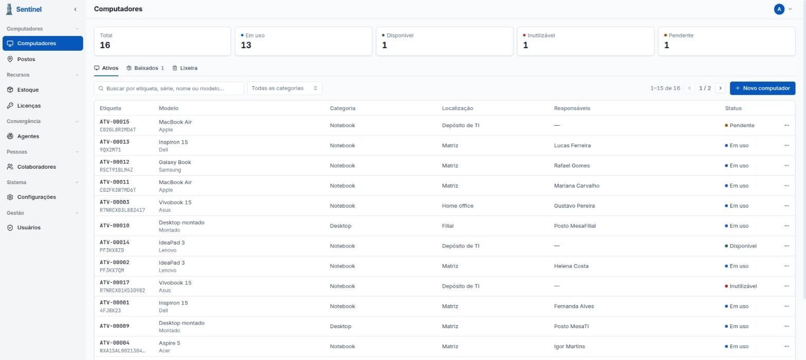
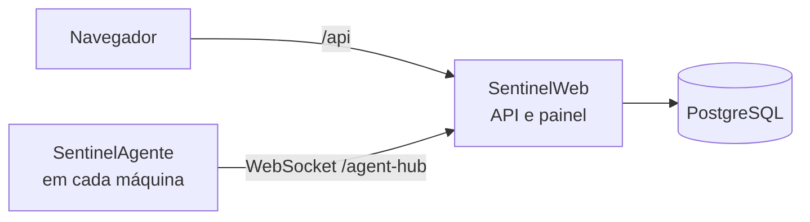
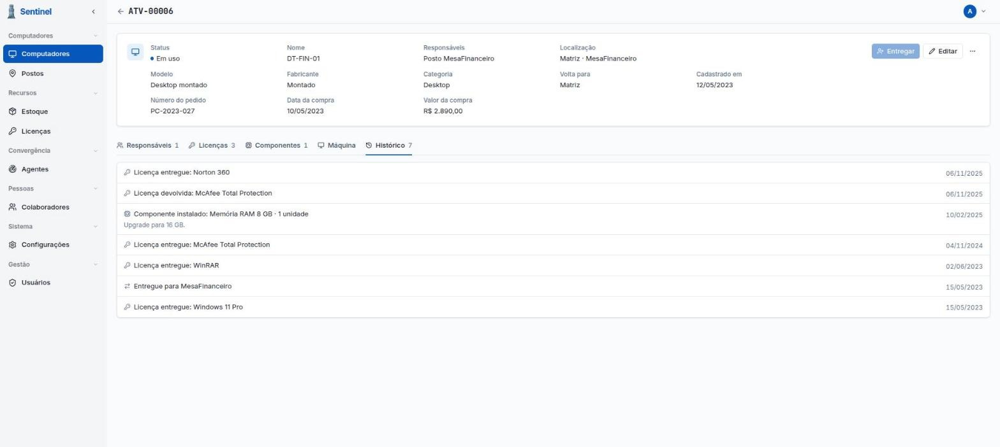
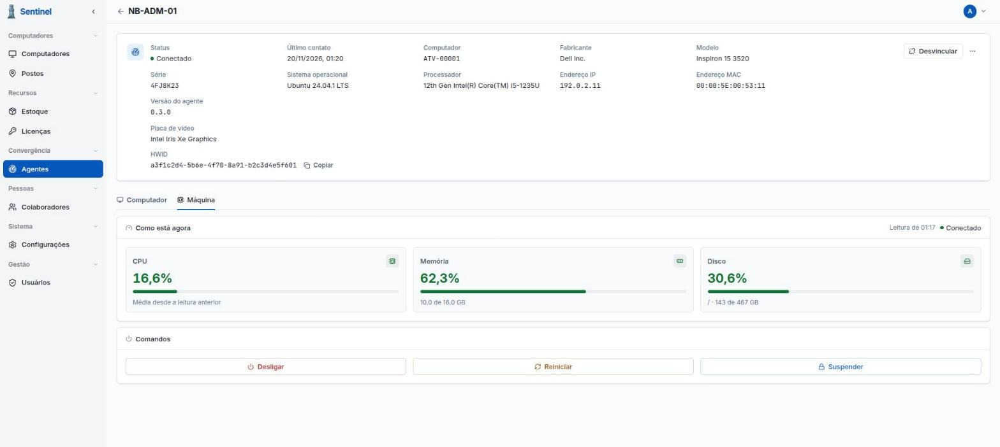
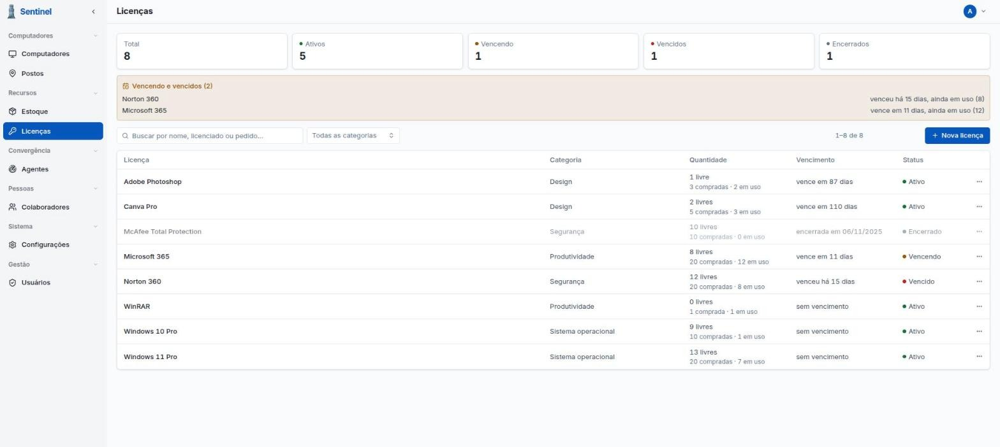
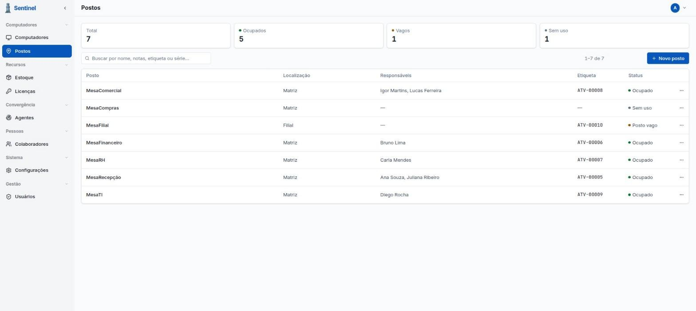

<div align="center">

<picture>
  <source media="(prefers-color-scheme: dark)" srcset="public/torre-sem-fundo-dark.svg">
  <source media="(prefers-color-scheme: light)" srcset="public/torre-sem-fundo-light.svg">
  
</picture>

# SentinelWeb

**O inventário da TI (computadores, postos, estoque e licenças, e com quem está cada um), ligado ao que o
[SentinelAgente](https://github.com/pauloeduas-software/SentinelAgente) vê em cada máquina.**

[](./LICENSE)
[](https://github.com/pauloeduas-software/SentinelWeb/actions/workflows/ci.yml)

</div>

<picture>
  <source media="(prefers-color-scheme: dark)" srcset=".github/readme/computadores-escuro.jpg">
  <source media="(prefers-color-scheme: light)" srcset=".github/readme/computadores-claro.jpg">
  
</picture>

O SentinelWeb é o painel de quem cuida da TI de uma empresa: o que ela tem, com quem está, desde quando e
em que estado. O SentinelAgente, instalado em cada máquina, conta ao painel o que a máquina é e como ela
está agora, e a série liga essa máquina ao computador cadastrado.

> [!NOTE]
> Só em português do Brasil, e a moeda é o real. O agente roda em Linux. O painel roda a partir do
> código-fonte, com o Postgres no Docker.

## O que ele faz

- **Computadores:** etiqueta e série, entrega e devolução, baixa que se reverte, lixeira e o histórico de cada um.
- **Postos:** um computador por posto, quem está em cada turno, e Registrar saída.
- **Estoque:** o que se conta por quantidade, entregue a colaborador ou posto; a peça instalada mostra o computador.
- **Licenças:** quantidade comprada, chaves, entregas, e o aviso do que vence nos próximos 30 dias ou já venceu.
- **Agentes:** a máquina se liga ao computador pela série, manda CPU, memória e disco, e recebe desligar,
  reiniciar e suspender.
- **Três cargos:** o Técnico opera; o Supervisor exclui, dá baixa e vê o valor da compra; o Administrador cuida
  dos usuários. Toda escrita guarda quem fez.
- **O banco recusa o que não pode ser:** o que está em uso não se exclui, nenhuma data fica no futuro e nada
  acontece antes da compra.

## Como funciona



A API é Fastify com Prisma, e o painel é React com Vite. O agente fica conectado e responde aos comandos do
painel; o que ele manda e recebe está em [`agente.md`](./docs/referencia/agente.md).

## Telas

<table>
  <tr>
    <td width="50%">
      <picture>
        <source media="(prefers-color-scheme: dark)" srcset=".github/readme/ficha-do-computador-escuro.jpg">
        <source media="(prefers-color-scheme: light)" srcset=".github/readme/ficha-do-computador-claro.jpg">
        
      </picture>
      <p align="center">A ficha do computador e o histórico dele</p>
    </td>
    <td width="50%">
      <picture>
        <source media="(prefers-color-scheme: dark)" srcset=".github/readme/agente-escuro.jpg">
        <source media="(prefers-color-scheme: light)" srcset=".github/readme/agente-claro.jpg">
        
      </picture>
      <p align="center">A máquina que o agente apresenta, agora</p>
    </td>
  </tr>
  <tr>
    <td width="50%">
      <picture>
        <source media="(prefers-color-scheme: dark)" srcset=".github/readme/licencas-escuro.jpg">
        <source media="(prefers-color-scheme: light)" srcset=".github/readme/licencas-claro.jpg">
        
      </picture>
      <p align="center">As licenças e o que vence</p>
    </td>
    <td width="50%">
      <picture>
        <source media="(prefers-color-scheme: dark)" srcset=".github/readme/postos-escuro.jpg">
        <source media="(prefers-color-scheme: light)" srcset=".github/readme/postos-claro.jpg">
        
      </picture>
      <p align="center">Os postos, ocupados e vagos</p>
    </td>
  </tr>
</table>

O menu inteiro, tela por tela, está em [`telas.md`](./docs/referencia/telas.md#o-menu).

## Rodar

Precisa de Node.js 22 ou mais novo, Bun e Docker.

```bash
bun install
cp .env.example .env
docker compose up -d
bun run db:migrate
bun run db:seed:demo    # dados de exemplo e a conta admin@sentinel.com (senha admin)
bun run dev             # o painel em http://localhost:3000
```

As portas, o `.env`, os scripts e como rodar em produção estão em
[`preparar-o-ambiente.md`](./docs/guias/preparar-o-ambiente.md).

## Documentação

- [`docs/README.md`](./docs/README.md): o mapa da documentação e por onde entrar.
- [`arquitetura.md`](./docs/referencia/arquitetura.md): as camadas, os módulos e o que o lint recusa.
- [`invariantes.md`](./docs/referencia/invariantes.md): o que o banco recusa, e onde.
- [`decisoes/`](./docs/decisoes/README.md): o porquê de cada regra.

Dúvida ou bug: abra uma [issue](https://github.com/pauloeduas-software/SentinelWeb/issues).

## Licença

**[GNU AGPL, versão 3 ou posterior](./LICENSE)** (`AGPL-3.0-or-later`). Qualquer um pode usar, alterar e
redistribuir. Quem redistribuir, alterado ou não, mantém a mesma licença e entrega o código-fonte; quem alterar
e oferecer a outros pela rede, também. Vem sem garantia nenhuma. Parte de `src/components/ui/` vem do
shadcn/ui, sob MIT, com o [aviso](./src/components/ui/LICENSE-shadcn-ui.md) ao lado. O porquê da escolha está
na [DO](./docs/decisoes/plataforma.md#do--o-sentinelweb-é-agpl-30-or-later).
